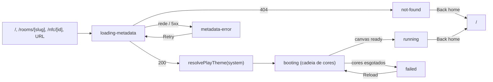

# Design: SF01 Play Screen Themes

## TL;DR
Design contract da SF01 do {{doc:0002F}}: a tela `/play/[slug]` deixa de ser um cartão com iframe fixo de 600px e passa a ser um palco de tela inteira, sem rolagem, com a moldura do console desenhada pela página em volta do emulador. Cada um dos 12 sistemas tem um tema validado no código (`lib/play-theme.ts`) e um tema `neutral` cobre sistema desconhecido. O layout reserva três espaços para a SF02 (legenda no PC, camada do controle virtual no toque, botão de tela cheia) que não mudam o tamanho do quadro.

## TOC
- [Screens](#screens)
- [Components](#components)
- [Flows](#flows)
- [Tokens](#tokens)
- [Design Contract](#design-contract)
- [References](#references)
- [Design Review](#design-review)

## Screens
A SF01 não cria tela nova; ela reestrutura `/play/[slug]` e define seis estados dessa tela.

| screen | purpose | primary action | entry |
|---|---|---|---|
| `/play/[slug]` | Jogar um jogo num quadro responsivo com a moldura do console | Por estado (ver tabela de estados) | `/` (`app/page.tsx:33`), `/rooms/[slug]` (`app/rooms/[slug]/page.tsx:51`), redirect do NFC (`app/nfc/[id]/page.tsx:44`), URL direta |

Layout tree (mobile-first, base 320px):

```json
{"screen":"play","regions":[{"role":"header","order":1,"span":{"mobile":"full","desktop":"full"},"component":"PlayTopBar","contains":["back-link","game-title","system-label","fullscreen-slot"]},{"role":"stage","order":2,"span":{"mobile":"full","desktop":"full"},"component":"ThemedFrame","contains":["Emulator","state-panel"]},{"role":"overlay","order":3,"span":{"mobile":"full","desktop":"hidden"},"component":"touch-overlay-slot","contains":["SF02 virtual controller"]},{"role":"status","order":4,"span":{"mobile":"full","desktop":"full"},"component":"StatusStrip","contains":["status-text"]},{"role":"legend","order":5,"span":{"mobile":"hidden","desktop":"full"},"component":"legend-slot","contains":["SF02 key legend"]}]}
```

**Palco e tamanho do quadro.** A raiz (`PlayStage`) ocupa `100dvh` em coluna e esconde a rolagem. O quadro fica com a altura que sobra (`flex-1 min-h-0`). A largura é `min(100%, altura restante × proporção)`, com `aspect-ratio: var(--t-ar)`. Barra de topo, faixa de status e legenda são linhas de altura fixa, então a soma delas cabe em 390×844, 844×390 e 1366×768.
- **390×844 (retrato):** o quadro ocupa a largura; a área livre abaixo dele mostra `--t-bg`.
- **844×390 (paisagem):** o quadro ocupa a altura e fica centrado; a barra de topo vira uma linha compacta, com o título truncado.
- **1366×768 (PC):** a linha da legenda aparece abaixo do quadro só com `(pointer: fine)`.

**Espaços reservados para a SF02** (vazios na SF01):
- `legend-slot`: linha de 40px (`h-10`), visível só com `(pointer: fine)`. A altura já está na conta das linhas fixas.
- `touch-overlay-slot`: camada `absolute inset-0` posicionada sobre a área do palco abaixo da barra de topo (quadro + área livre). Ela é visível só com `(pointer: coarse)`. Fica por cima e nunca ocupa espaço no layout. Quem decide o `pointer-events` dos botões é a SF02.
- `fullscreen-slot`: célula de 44×44 na barra de topo.

Estados:

| state | quando | ThemedFrame | StatusStrip | primary CTA | secondary |
|---|---|---|---|---|---|
| loading-metadata | montagem, buscando `/api/game/{slug}` | Sem moldura e sem proporção: skeleton que ocupa a área do palco, `motion-safe:animate-pulse` | "Loading game..." | — | Back home |
| not-found | `/api/game` respondeu 404 | Tema `neutral`; painel no quadro: "Game not found" | "Not found" | Back home | — |
| metadata-error | falha de rede ou status ≠ 200/404 | Tema `neutral`; painel: "Could not load game info." | "Error" | Retry (busca os metadados de novo) | Back home |
| booting | metadados ok, `Emulator` montado | Moldura do console, proporção final | "Starting game (attempt {n} of {total})..."; nome do core só em texto visualmente oculto | — | Back home |
| running | `EMULATOR_CANVAS_READY` | Canvas visível | "Running", `text-xs` em `--t-muted`, mesma altura | — | Back home |
| failed | todos os cores falharam | A moldura fica; painel no quadro: "Could not start this game. Check your connection and try again." | "Failed" | Reload (remonta o `Emulator` e recomeça do primeiro core, sem recarregar a página) | Back home |

O painel de estado (`state-panel`) fica no centro do quadro, sobre `--t-bg`, com texto em `--t-text`. Na paisagem 844×390 a mensagem e o botão também ficam dentro do quadro; a faixa de status mostra só o rótulo curto.

## Components
Quatro componentes novos e um módulo puro; o `Emulator` é o único reaproveitado.

- `PlayStage` — new, `components/PlayStage.tsx` — props: `slug`, `game` (metadados ou `null`), `metaState` — estados: os seis da tabela acima; aplica as custom properties do tema por `style` inline e `data-frame` — composed-of: [PlayTopBar, ThemedFrame, StatusStrip]
- `PlayTopBar` — new, `components/PlayTopBar.tsx` — props: `title`, `systemLabel`, `children` (fullscreen-slot) — estados: default — composed-of: [next/link "Back home", h1, system label]
- `ThemedFrame` — new, `components/ThemedFrame.tsx` — props: `frameStyle`, `state`, `children` — estados: skeleton, framed, panel (not-found / metadata-error / failed) — composed-of: [Emulator]
- `StatusStrip` — new, `components/StatusStrip.tsx` — props: `state`, `attempt`, `total`, `coreName` — estados: os seis — `role="status"` nos estados normais; o painel de failed / metadata-error usa `role="alert"` — composed-of: []
- `Emulator` — existing, `components/Emulator.tsx` — recebe `onStatusChange(state, attempt, total, core)`; perde a barra de status própria (`:196-198`) e a altura fixa (`:206`); o iframe vira `w-full h-full` e mantém `title="Play {gameTitle}"` e `allow="fullscreen"`; a cadeia de cores (`:16-44`) não muda — composed-of: [iframe]
- `lib/play-theme.ts` — new, módulo puro (sem React, sem banco) — temas padrão dos 12 sistemas e `neutral`, `resolvePlayTheme(system)`, validação (RN02) e checagem de contraste — composed-of: []

**Ordem de tabulação:** Back home é o primeiro elemento focável; depois o iframe. Como sair do iframe pelo teclado é assunto da SF02 (captura de teclado).

## Flows
Um fluxo principal com quatro saídas.



- Tema: `system` (ou `console`) → `resolvePlayTheme` → tema do console → valor inválido ou sistema desconhecido → `neutral`. Nenhum passo lê o MongoDB; `/api/game` já tem fallback para dados mock (`lib/data.ts`).
- Viewport ou orientação muda → mesmo estado → o quadro se reajusta por `dvh` + `aspect-ratio`, sem rolagem.

## Tokens
Os temas são valores validados no código; a página os aplica como custom properties por `style` inline, porque o Tailwind só gera classes que encontra em `app/**` e `components/**`.

Custom properties: `--t-bg`, `--t-accent`, `--t-frame`, `--t-text`, `--t-muted`, `--t-ar`. `--t-text` é `#F4F4F5` ou `#18181B`, escolhido pela luminância de `--t-bg`. `--t-muted` = `--t-text` com 72% de opacidade. O anel de foco usa `--t-accent`. A borda de 1px da moldura usa `--t-accent` e deixa a moldura visível mesmo quando `--t-frame` é próximo de `--t-bg`. Nenhum texto é desenhado sobre `--t-frame`.

Estilos de moldura (`data-frame`, lista fechada de 13): `nes`, `snes`, `n64`, `dmg`, `gbc`, `gba`, `sms`, `megadrive`, `gamegear`, `ps`, `arcade`, `neogeo`, `neutral`. Cada estilo tem uma regra em `app/globals.css`.

```json
{"themes":{"NES":{"frame":"nes","bg":"#1F1F23","accent":"#FF4D4D","frameColor":"#C9C9C9","ar":"4/3","radius":"12px"},"SNES":{"frame":"snes","bg":"#2A2833","accent":"#B6A6FF","frameColor":"#D3D3DB","ar":"4/3","radius":"12px"},"Nintendo 64":{"frame":"n64","bg":"#141414","accent":"#3BB273","frameColor":"#3A3A3A","ar":"4/3","radius":"12px"},"Game Boy":{"frame":"dmg","bg":"#1E2A1E","accent":"#9BBC0F","frameColor":"#C4C0B4","ar":"10/9","radius":"24px"},"Game Boy Color":{"frame":"gbc","bg":"#1B1530","accent":"#FFD23F","frameColor":"#7A3FB0","ar":"10/9","radius":"24px"},"Game Boy Advance":{"frame":"gba","bg":"#15142B","accent":"#8F8FFF","frameColor":"#4B3FA6","ar":"3/2","radius":"24px"},"Master System":{"frame":"sms","bg":"#121212","accent":"#FF4545","frameColor":"#2B2B2B","ar":"4/3","radius":"12px"},"Mega Drive / Genesis":{"frame":"megadrive","bg":"#0D0D0D","accent":"#F2C14E","frameColor":"#1A1A1A","ar":"4/3","radius":"12px"},"Game Gear":{"frame":"gamegear","bg":"#111111","accent":"#4FA3FF","frameColor":"#2A2A2A","ar":"10/9","radius":"24px"},"PlayStation":{"frame":"ps","bg":"#1C1C24","accent":"#7FB2FF","frameColor":"#B9B9BE","ar":"4/3","radius":"12px"},"Arcade (FBNeo)":{"frame":"arcade","bg":"#0B0B1A","accent":"#FF3EA5","frameColor":"#1F1F3A","ar":"4/3","radius":"12px"},"Neo Geo":{"frame":"neogeo","bg":"#0E0E0E","accent":"#E3B23C","frameColor":"#2C2C2C","ar":"4/3","radius":"12px"},"neutral":{"frame":"neutral","bg":"#09090B","accent":"#22D3EE","frameColor":"#27272A","ar":"4/3","radius":"16px"}},"bezel":{"thickness":"clamp(8px, 1.5vmin, 20px)"},"rows":{"legend":"40px","touchTarget":"44px","targetGap":"8px"},"text":{"light":"#F4F4F5","dark":"#18181B","mutedOpacity":0.72}}
```

Contraste medido (2026-11-06, fórmula WCAG): texto sobre `--t-bg` de 13,18:1 (SNES) a 18,10:1 (neutral); destaque sobre `--t-bg` de 5,02:1 (NES) a 12,15:1 (GBC).

## Design Contract
Compromissos da SF01 que o QA verifica; os valores vêm de `design-context` (zinc/cyan) e dos tokens acima.

| Dimension | Declares | Verified by | Method |
|---|---|---|---|
| Spacing scale | Passos Tailwind 1, 2, 3, 4, 6, 8 (herdados); desvio justificado: espessura da moldura `clamp(8px, 1.5vmin, 20px)` | Computed style | Gap/padding capturados vs conjunto de passos |
| Token allowlist | Cores do palco só de `--t-bg`, `--t-accent`, `--t-frame`, `--t-text`, `--t-muted`; skeleton com zinc-900/800 | Computed style | Nomes das custom properties resolvidas e cores computadas |
| Theme validity | 13 temas: hex `#RRGGBB`, `data-frame` da lista fechada, proporção da lista `4/3`, `10/9`, `3/2`; valor inválido → padrão do console → `neutral` | Unit test | `tests/play-theme.test.ts` |
| Contrast target | Texto ≥ 4,5:1 e destaque ≥ 4,5:1 sobre `--t-bg` nos 13 temas; tema que falha cai no padrão | Unit test + axe-core (`color-contrast`) | Regra determinística |
| Minimum tap target | 44px em Back home, Retry, Reload e fullscreen-slot, com 8px entre alvos | axe-core (`target-size`) | Regra determinística |
| Radius | Moldura 12px (consoles de mesa), 24px (portáteis), 16px (`neutral`) | Computed style | `border-radius` capturado |
| Typographic scale | Título `text-lg` (mobile) a `text-2xl` (desktop) semibold; system label `text-xs` uppercase; status `text-sm`, `text-xs` em running; família: `unknown` — o projeto não define fonte | Computed style | font-size/weight capturados |
| Grid/container | Palco `100dvh`, sem cartão `max-w`; quadro = `min(100%, altura restante × --t-ar)` | Computed style | Largura/altura do quadro vs proporção |
| Breakpoint behaviour | 390×844, 844×390, 1366×768: quadro inteiro visível, sem rolagem da página (`scrollHeight ≤ innerHeight`); legenda só com `pointer: fine`; overlay não muda o tamanho do quadro | Screenshot + computed style | Juízo do agente + medida |
| Layout stability | Depois que o quadro aparece (booting), a caixa do quadro não muda de tamanho até running/failed | Computed style | Caixa do quadro capturada em booting e running |
| Required states | loading-metadata, not-found, metadata-error, booting, running, failed | Evidence set | Comparação dos arquivos de estado capturados |
| Primary CTA count | No máximo 1 por estado (tabela de estados) | Screenshot | Juízo do agente |
| Visual hierarchy | Quadro primeiro, barra de topo segundo, faixa de status terceiro | Screenshot | Juízo do agente |
| Motion | `prefers-reduced-motion: reduce` desliga o pulse do skeleton e qualquer transição da moldura | Computed style | `animation-name` com reduce emulado |

## References
- {{doc:0002F}} — epic; SF01 é dona do layout da página e do quadro.
- `docs/features/0002F-emulator-themes-controls/subfeatures/SF02-emulator-controls/about.md` — legenda, controle virtual e tela cheia que usam os espaços reservados.
- `.codeadd/wiki/domains/frontend.md` (Styling) — vocabulário zinc/cyan e alcance do Tailwind.
- Fonte de estilo: ui-ux-pro-max não rodou (`python3`/`python` aqui são só o alias da Windows Store); usados os tokens inspecionados e os padrões do `add--ux-design`.

## Design Review
Os 13 itens da crítica (@ux-agent, modo crítica) e a decisão de cada um.

| Item | Severity | Decision | Rationale |
|---|---|---|---|
| 1 — 404 e erro de rede caíam no boot do emulador | major | accepted | Estados `not-found` (Back home, sem boot) e `metadata-error` (Retry) separados |
| 2 — troca de proporção ao resolver o tema | major | accepted (com ajuste) | O skeleton não tem proporção; o quadro só aparece com a proporção final. Recusado passar `initialGame` por server component: mudaria o caminho de leitura de uma página em produção, e `/api/game` continua a única leitura |
| 3 — dois CTAs primários e mensagem de falha em dois lugares | major | accepted | Um CTA primário por estado; a mensagem fica no painel do quadro; a faixa mostra rótulo curto |
| 4 — estado failed não cabe em 844×390 | major | accepted | Mensagem e Reload ficam no quadro em todas as orientações |
| 5 — controle virtual cobriria a imagem no retrato | major | accepted | `touch-overlay-slot` cobre o palco abaixo da barra (quadro + área livre); continua por cima e não muda o tamanho, como pede o RF02 da SF01 |
| 6 — contraste só checado contra `--t-bg` | major | accepted (com ajuste) | Destaque sobe para ≥ 4,5:1, nenhum texto sobre `--t-frame`, foco em `--t-accent`, borda de 1px em `--t-accent`; recusado 3:1 entre moldura e fundo, porque consoles escuros têm moldura escura e a borda já os separa |
| 7 — radius, linha da legenda, label e clamp sem valor | minor | accepted | Valores na tabela Tokens e no contrato |
| 8 — Reload sem semântica | minor | accepted | Reload remonta o `Emulator` e recomeça do primeiro core; Retry só refaz a busca de metadados |
| 9 — faixa de status chama atenção durante o jogo | minor | accepted | Em running mostra "Running" em `text-xs` `--t-muted`, mesma altura |
| 10 — foco e título do iframe | minor | accepted | Back home primeiro na ordem de foco; iframe mantém `title`; saída do iframe pelo teclado fica com a SF02 |
| 11 — Back home sem confirmação perto do controle | minor | rejected | Confirmação é decisão de produto fora do pedido; Back home fica na barra de topo, 44px e 8px de distância |
| 12 — nomes de core parecem debug | polish | accepted | Texto "Starting game (attempt n of m)..." e "Running"; core só em texto visualmente oculto |
| 13 — `role="status"` + `aria-live` redundantes | polish | accepted | `role="status"` na faixa; `role="alert"` no painel de failed e metadata-error |
