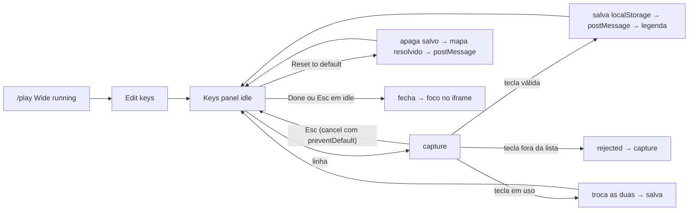

# Design: SF02 Emulator Controls

## TL;DR
Design contract da SF02 do {{doc:0002F}}. Ela encaixa os controles nos espaços que a SF04 ({{doc:0002F-SF04}}, `subfeatures/SF04-console-bezels/design.md`) deixou. Em `Wide` e em paisagem, o tamanho e a proporção da janela do jogo não mudam.
- **Wide:** a linha da legenda mostra a tecla de cada botão do console e o botão "Edit keys". Ele abre o painel "Keys", onde o jogador remapeia e volta ao padrão. O mapa fica salvo no `localStorage` do aparelho.
- **Celular em pé (toque + retrato): modo portátil.** O palco vira o corpo de um console portátil, no estilo do Game Boy, na cor do console em uso: tela em cima, dentro de uma moldura com LED, e controles embaixo (D-pad, botões de ação, Select/Start, gatilhos). Vale para os 12 consoles; cada um tem os próprios botões e cores (decisão do dono, 2026-11-11).
- **Celular deitado (toque + paisagem):** o controle virtual fica nas faixas dos lados da janela, como no plano original.
- **Sugestão de girar:** removida. O modo portátil é o layout principal em pé (decisão do dono, 2026-11-11).
- **Tela cheia:** o botão ocupa o slot 44×44 da barra de topo em todo viewport que suporta a API.

O controle embutido do EmulatorJS fica desligado (decisão do dono, epic.md Notes 2026-11-09).

## TOC
- [Screens](#screens)
- [Components](#components)
- [Flows](#flows)
- [Tokens](#tokens)
- [Design Contract](#design-contract)
- [References](#references)
- [Design Review](#design-review)

## Screens
A SF02 não cria rota nem região nova no fluxo. Ela preenche três slots de `/play/[slug]` e abre um diálogo.

**`Wide`** = `(min-width: 1024px) and (pointer: fine)`. **Celular** = fora de `Wide`. **Toque** = `(pointer: coarse)`, a mesma regra do slot `touch-overlay`.

| screen | purpose | primary action | entry |
|---|---|---|---|
| Linha da legenda (`data-slot="legend"`, Wide) | Mostrar a tecla de cada botão do console em uso | nenhuma (Edit keys é secundário) | `/play/[slug]` em Wide |
| Painel Keys (`<dialog>` modal, Wide) | Remapear teclas do console e voltar ao padrão | Done | botão Edit keys da legenda |
| Modo portátil (toque, retrato) | Palco como console portátil: tela em cima, controle embaixo | nenhuma (controle de jogo) | aparece sozinho com `(pointer: coarse) and (orientation: portrait)` |
| Controle virtual (`data-slot="touch-overlay"`, toque) | Botões do console por toque, com multitoque | nenhuma (controle de jogo) | aparece sozinho com toque, em booting e running |
| Tela cheia (`data-slot="fullscreen"`) | Entrar e sair da tela cheia do palco | nenhuma (botão de utilidade) | barra de topo, todo viewport com `document.fullscreenEnabled` |

Layout trees (base mobile 320px; ordem das regiões = ordem no DOM):

```json
{"screen":"play-wide-legend","regions":[{"role":"legend","order":1,"span":{"mobile":"hidden","desktop":"full"},"component":"ControlsLegend","contains":["KeyChip per button or directional set"]},{"role":"action","order":2,"span":{"mobile":"hidden","desktop":"auto"},"component":"ControlsLegend","contains":["edit-keys button"]}]}
{"screen":"keys-panel","regions":[{"role":"header","order":1,"span":{"mobile":"n/a","desktop":"full"},"component":"KeysPanel","contains":["title Keys","console name"]},{"role":"list","order":2,"span":{"mobile":"n/a","desktop":"full"},"component":"KeysPanel","contains":["KeyRow per console button"]},{"role":"status","order":3,"span":{"mobile":"n/a","desktop":"full"},"component":"KeysPanel","contains":["status line"]},{"role":"footer","order":4,"span":{"mobile":"n/a","desktop":"full"},"component":"KeysPanel","contains":["reset-to-default","done"],"primaryCta":"done"}]}
{"screen":"play-phone-portrait (modo portátil)","regions":[{"role":"topbar","order":1,"span":{"mobile":"full","desktop":"n/a"},"component":"PlayTopBar","contains":["back home","title","fullscreen"]},{"role":"shell","order":2,"span":{"mobile":"full","desktop":"n/a"},"component":"PlayStage (.play-shell)","contains":["screen panel (LED, window, status strip)","brand line","controller deck"]},{"role":"controller","order":3,"span":{"mobile":"full","desktop":"n/a"},"component":"VirtualController","contains":["shoulder row","left cluster","right cluster","center row (Select, Start, N64 toggle)","speaker grille (decorativa)"]}]}
{"screen":"play-phone-landscape","regions":[{"role":"left","order":1,"span":{"mobile":"side band","desktop":"n/a"},"component":"VirtualController","contains":["left shoulders","left cluster","left center buttons"]},{"role":"right","order":2,"span":{"mobile":"side band","desktop":"n/a"},"component":"VirtualController","contains":["right shoulders","right cluster","right center buttons"]}]}
```

**Botões por console (listas fechadas, base da legenda, do painel e do controle):**

| console | botões |
|---|---|
| NES, Game Boy, Game Boy Color | D-pad, B, A, Select, Start |
| Game Boy Advance | D-pad, B, A, L, R, Select, Start |
| SNES | D-pad, Y, X, B, A, L, R, Select, Start |
| Nintendo 64 | Stick, D-pad, A, B, C-up, C-down, C-left, C-right, Z, L, R, Start |
| Master System, Game Gear | D-pad, 1, 2, Start (rótulo "Pause" no Master System) |
| Mega Drive | D-pad, A, B, C, Start |
| PlayStation | D-pad, Square, Triangle, Cross, Circle, L1, L2, R1, R2, Select, Start |
| Arcade, Neo Geo | Stick (4 direções), A, B, C, D, Coin, Start |

**Linha da legenda (Wide):**
- **Altura:** a mesma linha `h-10` da SF04, no fluxo, depois do `StatusStrip`.
- **Chips:**
  - Um chip por botão. Conjuntos de direção (D-pad, Stick, as quatro C do N64) viram um chip só, com as 4 teclas.
  - Formato do chip: `rótulo` + tampa de tecla, por exemplo `A [X]` e `D-pad [↑ ↓ ← →]`. Select e Start são chips separados.
  - Pior caso: PlayStation com 11 chips e N64 com 9, mais o Edit keys, dentro de 1024px. Nenhum chip pode ser cortado (Design Contract).
- **Edit keys:** fica à direita, `shrink-0`, como botão secundário. Ocupa a altura da linha (40px), com largura mínima de 44px. É um desvio declarado: só existe em Wide, com mouse (C8).

**Painel Keys:**
- **Diálogo:** `<dialog>` nativo, aberto com `showModal()`. Centrado, `max-w-md`, `max-h-[80vh]`. Cabeçalho e rodapé fixos; a lista rola.
- **Superfície:** fundo `--t-bg`, borda 1px `--t-frame`, raio `--t-radius`, padding `p-6`, fundo de trás `bg-black/60`.
- **Linhas:** `KeyRow` com `min-h-11`. O rótulo do botão fica à esquerda; à direita, um botão com a tecla atual.
- **Rodapé:** Reset to default (pill com contorno, secundário) e Done (`ACTION_CLASS`, único primário).

**Controle virtual (toque):**
- **Camada:** o overlay é `pointer-events-none`; só os botões recebem eventos.
- **Margem de baixo:** a altura do `StatusStrip` (`h-8`) mais `env(safe-area-inset-bottom)`. Em paisagem, as margens laterais usam `env(safe-area-inset-left/right)`.
- **Clusters (132px por lado):**
  - D-pad e Stick ocupam uma grade de 3×44px. As 4 zonas do D-pad formam um controle só, então não há folga de 8px entre elas.
  - Face buttons ficam em losango ou par numa grade de 132px.
  - Arcade e Neo Geo: A, B, C, D em grade 2×2 de 44px, com 8px de folga.
- **Gatilhos:** uma linha de 44px acima de cada cluster. No PlayStation, L1 e L2 ficam lado a lado (96px), e R1 e R2 também.
- **Coluna do meio:** entre os clusters, com Select/Start/Pause/Coin empilhados, 44px cada e 8px de folga.
- **N64:** o cluster esquerdo alterna entre Stick e D-pad por um botão "D-pad"/"Stick" de 44px na coluna do meio, acima de Start. O cluster direito usa uma grade 3×3 de 44px: C em losango, A e B nos cantos de baixo. Z fica na linha de gatilhos, no centro.

**Modo portátil (toque + retrato), substitui a geometria de retrato anterior (decisão do dono, 2026-11-11):**
- **Quando:** `(pointer: coarse) and (orientation: portrait)`. É regra de CSS sobre a mesma árvore DOM, então girar o aparelho nunca remonta o iframe nem reinicia o jogo.
- **Corpo (`.play-shell`):**
  - Ocupa o palco abaixo da barra de topo, com margem de 8px e largura máxima de 480px, centrado.
  - Fundo `--t-frame` com gradiente suave: mais claro em cima, mais escuro embaixo, misturado por `color-mix`.
  - Cantos de 28px, com o canto de baixo à direita de 72px, como no Game Boy.
  - Sombra externa e um brilho de 1px no topo dão o volume de plástico.
- **Painel da tela (`.play-screen`):**
  - Vidro escuro: `color-mix(--t-frame 18%, #111114)`, cantos de 14px e canto de baixo à direita de 40px.
  - Em cima, a linha do LED: ponto de 8px que acende em `--t-accent` com brilho em running e fica cinza nos outros estados, mais o texto "POWER" em `text-xs`.
  - A janela do jogo fica centrada e ocupa a largura do vidro. A altura sai da proporção do console e é limitada para o controle sempre caber.
  - O `StatusStrip` fica sobre a base do vidro, numa faixa de 32px reservada abaixo da janela, então não cobre o jogo.
- **Linha da marca:** "RetroKey" em itálico semibold mais o nome do console em `text-sm`, na cor `--t-on-frame` sobre o corpo.
- **Deck de controle:** ocupa o resto da altura, com os grupos centrados na vertical.
  - **Gatilhos:** linha de cima, com pills de 64×44 encostadas nas bordas. No PlayStation, L1/L2 e R1/R2 ficam lado a lado. O Z do N64 fica no centro.
  - **Cluster esquerdo:** D-pad em cruz de 3×48px (144px), afundado num poço circular. Arcade e Neo Geo usam um joystick de bola, e o N64 usa analógico ou D-pad pelo botão de troca.
  - **Cluster direito (156px):** os botões de ação no arranjo do console original, descritos em "Botões de ação por console".
  - **Linha do meio:** Select/Start (ou Coin/Start, ou Pause), pills inclinadas a −20° com o rótulo embaixo; cada alvo tem 44×44.
  - **Grade do alto-falante:** 6 fendas diagonais no canto de baixo à direita, decorativa (`aria-hidden`).
- **Orçamento de altura (390×844):** barra de topo 52px; corpo com margem 8px; vidro: 4/3 → janela 334×250 + LED 24 + strip 32 + padding 28 = 334px; marca 28px; o deck fica com cerca de 380px, para 300px necessários com gatilhos. Em 360×640, a janela encolhe até o deck ter 300px.
- **Tablets em pé:** a mesma regra, com o corpo limitado a 480px de largura e centrado.

**Botões de ação por console (modo portátil e paisagem):**

| console | arranjo | cores (preenchimento / rótulo) |
|---|---|---|
| NES | B e A lado a lado, A mais alto | vermelho `#C8102E` / branco |
| Game Boy | B e A na diagonal, A acima à direita | magenta `#9A2257` / branco |
| Game Boy Color | B e A na diagonal | cinza claro `#E4E4EA` / `#18181B` |
| Game Boy Advance | B e A na diagonal; L e R nos gatilhos | lilás claro `#D9D9E3` / `#18181B` |
| SNES | losango X (cima), Y (esquerda), A (direita), B (baixo) | X `#3B5BA9`, Y `#1E8F4E`, A `#C8102E` / branco; B `#E0B020` / `#18181B` |
| Nintendo 64 | C amarelos em losango; A e B nos cantos de baixo; Z e L/R nos gatilhos | A `#2456C8`, B `#1E8F4E` / branco; C `#E8B000` / `#18181B`; Start `#C8102E` |
| Master System, Game Gear | 1 e 2 na diagonal | `--t-accent` / `#18181B` |
| Mega Drive | A, B, C em arco | `--t-accent` / `#18181B` |
| PlayStation | losango △ (cima), □ (esquerda), ○ (direita), ✕ (baixo) | fundo `#2B2B30` com símbolo △ `#3DDC97`, ○ `#FF6B6B`, ✕ `#7FB2FF`, □ `#F49AC2` |
| Arcade | A, B, C, D em grade 2×2 | A `#FF3EA5`, B `#22D3EE`, C `#FFD23F`, D `#7CFC00` / `#18181B` |
| Neo Geo | A, B, C, D em arco | A `#E5322D`, B `#F2C14E`, C `#2FA84F`, D `#2D6CDF` / A, C, D branco; B `#18181B` |

- Todo botão de ação tem um anel de 2px `rgb(0 0 0 / .45)` e fica num poço mais escuro do corpo. O contraste de UI (≥3:1) é medido contra o poço.
- **Tom do corpo:** `data-shell="light|dark"` sai de `pickTextColor(--t-frame)`. Num corpo claro, o D-pad e os gatilhos são `#26262B`; num corpo escuro, `#5A5A64`.

**Geometria, paisagem 844×390:**
- **Faixas laterais:** a janela ocupa a altura do palco, e os clusters ficam nas faixas dos lados. Em 4/3, cada faixa tem 191px (147px com inset de 44px no lado do notch); 10/9 tem 230px; 3/2 tem 162px.
- **Faixa estreita:** se a faixa for mais estreita que 132px, o cluster pode avançar no máximo 24px sobre a borda da janela.
  - Nessa parte, o botão tem fundo `--t-bg` com opacidade 0.8 e contorno de 2px em `--t-accent`.
  - Ele nunca entra além de 24px.
- **Gatilhos e meio:** os gatilhos ficam no topo de cada faixa. Os botões da coluna do meio se dividem: Select (ou Coin) embaixo do cluster esquerdo, Start embaixo do direito. No N64, o botão D-pad/Stick fica embaixo do cluster esquerdo.

**Estados:**

| play state | legenda (Wide) | controle virtual (toque) | modo portátil: LED | tela cheia |
|---|---|---|---|---|
| loading-metadata, not-found, metadata-error, failed | linha reservada, vazia | deck desenhado, botões ocultos (paisagem: oculto) | cinza | visível |
| booting | chips visíveis, Edit keys `aria-disabled` | visível, inerte (`aria-disabled`, opacidade 0.6) | acende sem brilho | visível |
| running | chips e Edit keys ativos | ativo | `--t-accent` com brilho | visível |

**Estados do painel Keys:**

| state | when | UI |
|---|---|---|
| idle | painel aberto | linhas com a tecla atual; Reset desabilitado sem mapa salvo |
| capture | clique numa linha | linha em `--t-accent`; status "Press a key for {botão}. Esc cancels." |
| rejected | tecla fora da lista fechada (Tab, F1-F12, modificadores sozinhos); Escape não entra aqui, ele cancela a captura e volta a idle | status "That key can't be used. Pick another."; captura continua |
| swapped | tecla já usada por outro botão | as duas trocam; status "{tecla} was on {outro}; swapped." |
| saved | tecla aceita | status "Saved."; legenda atualiza |
| reset | Reset to default | mapa salvo apagado; status "Default keys restored."; Reset desabilitado |
| no-storage | `localStorage` lança | status "Keys can't be saved in this browser."; o mapa vale na sessão |

## Components
Quatro componentes novos; os existentes mudam só para montar os novos nos slots e para o modo portátil.

- `ControlsLegend` — new, `components/ControlsLegend.tsx` — props: `consoleId`, `map` (mapa resolvido), `status: PlayScreenState`, `onEdit(): void` — estados: vazio, booting, running — composed-of: [KeyChip, edit-keys button]
- `KeysPanel` — new, `components/KeysPanel.tsx` — props: `consoleId`, `map`, `hasSaved: boolean`, `storageOk: boolean`, `open: boolean`, `onRemap(button, code)`, `onReset()`, `onClose()` — estados: idle, capture, rejected, swapped, saved, reset, no-storage — composed-of: [dialog, KeyRow, status line, reset button, done button]
- `VirtualController` — new, `components/VirtualController.tsx` — props: `consoleId`, `status: PlayScreenState`, `onInput(button, pressed: boolean)` — estados: oculto, inerte, ativo, pressionado por botão; N64: stick ou d-pad — composed-of: [DPad, Stick, FaceButton, ShoulderButton, MenuButton, speaker grille]. Um único conjunto de botões; o CSS posiciona o deck no modo portátil e as faixas laterais na paisagem.
- `FullscreenToggle` — new, `components/FullscreenToggle.tsx` — props: `targetRef` (elemento `play-stage`) — estados: off, on, sem suporte (oculto) — composed-of: [icon button]
- `PlayStage` — existing — monta `ControlsLegend` no slot `legend`, `VirtualController` no slot `touch-overlay`, `KeysPanel` e `FullscreenToggle`; envolve frame, strip e controle em `.play-shell` / `.play-screen` (`display: contents` fora do modo portátil) — composed-of: [PlayTopBar, ThemedFrame, StatusStrip, ControlsLegend, VirtualController, KeysPanel]
- `PlayTopBar` — existing — recebe `FullscreenToggle` como `children` do slot `fullscreen`; sem outra mudança — composed-of: [next/link, h1, system label, FullscreenToggle]
- `StatusStrip` — existing — no modo portátil, fica sobre a base do vidro (32px reservados), não sobre o deck
- `Emulator` — existing — envia o mapa e o input ao iframe; nenhuma mudança visual — composed-of: [iframe]

Rest, pressed e inerte dos botões de toque:
- **Rest:** cada botão tem relevo próprio: um gradiente radial do preenchimento do console, a sombra de baixo `0 3px 0` mais escura e o anel de 2px. O rótulo é `text-sm` semibold.
- **Pressed:** o botão desce 2px (`translateY(2px)`), a sombra de baixo some e aparece uma sombra interna. A transição de `transform` é de 60ms, desligada com `prefers-reduced-motion`. No Android, `navigator.vibrate(8)` dá um toque curto quando existe.
- **Paisagem:** os mesmos botões, com fundo do deck `--t-bg` a 0.6 de opacidade e contorno de 2px em `--t-accent` em volta de cada cluster.
- **Inerte (booting):** opacidade 0.6 e `aria-disabled`.

## Flows
Cinco fluxos: remapear, voltar ao padrão, jogar por toque, tela cheia e mapa na carga.



- **Mapa na carga:** a cada `EMULATOR_CANVAS_READY` (inclui nova tentativa de core e Reload), o mapa é resolvido: salvo válido > mapa do console. Depois vai ao iframe por `postMessage`. Ida e volta conferem origem e janela (RN03).
- **Painel aberto:** foco preso no `<dialog>`. As teclas não chegam ao jogo. O jogo não é pausado (a pausa não foi verificada no EmulatorJS).
- **Fechar o painel:**
  - Done ativa no `click`.
  - O foco vai para `iframe.contentWindow.focus()` no frame seguinte ao `keyup`, então o Enter do Done não chega ao jogo como Start.
  - Sem iframe, o foco volta ao Edit keys.
- **Toque:**
  - `pointerdown` em um botão → `onInput(botão, true)` → `pointerup` → `onInput(botão, false)`.
  - O D-pad usa pointer capture, e deslizar troca a direção.
  - Em `pointercancel`, `blur`, `visibilitychange` e `orientationchange`, todos os botões são soltos.
  - Um clique sintético (leitor de tela) pressiona e solta em 100 ms.
- **Tela cheia:**
  - Toque → `requestFullscreen()` no `play-stage`. Não trava a orientação, porque o modo portátil em pé é o layout principal (dono, 2026-11-11).
  - `fullscreenchange` sincroniza `aria-pressed` e o rótulo "Full screen"/"Exit full screen".
  - Se o pedido é recusado, o botão fica desligado, sem mensagem.
- **Desktop estreito (< 1024px, mouse):** sem legenda, sem painel e sem controle virtual. O teclado funciona com o mapa resolvido, e a tela cheia funciona. É a regra D10 da SF04, mantida.

## Tokens
A SF02 cria uma custom property: `--t-on-frame`, a cor de texto sobre `--t-frame`, calculada por `pickTextColor(frameColor)` no `PlayStage` (o `playThemeCssVars` da SF01 continua com 7 propriedades). Ela é usada só na linha da marca do modo portátil. O resto usa os 7 tokens do palco, `#18181B` sobre `--t-accent` e as cores fixas da tabela "Botões de ação por console".

```json
{"handheld":{"media":"(pointer: coarse) and (orientation: portrait)","shell":{"maxW":"480px","margin":"8px","radius":"28px 28px 72px 28px","bg":"--t-frame + color-mix gradient"},"screen":{"bg":"color-mix(--t-frame 18%, #111114)","radius":"14px 14px 40px 14px","padding":"14px","led":"8px --t-accent","stripReserve":"32px"},"brand":"text-sm --t-on-frame","deckMin":"300px","dpad":"3x48px","face":{"two":"60px","four":"52px","n64C":"44px"},"shoulder":"64x44px","menu":"pill 48x14 visual, 44x44 target, rotate -20deg","pressed":{"translateY":"2px","transition":"transform 60ms","reducedMotion":"none"}},"cluster":{"size":"132px","cell":"44px","dpadGap":"0","buttonGap":"8px"},"shoulderRow":"44px","centerColumn":{"button":"44px","gap":"8px"},"landscapeOverlapMax":"24px","touchRest":{"bg":"--t-bg","opacity":0.6,"outline":"2px --t-accent","label":"--t-text text-sm semibold"},"touchOverlap":{"bg":"--t-bg","opacity":0.8,"outline":"2px --t-accent"},"legend":{"row":"h-10","chip":"text-xs --t-text","keycap":"1px --t-muted border, --t-text","editKeys":"h-10 min-w-11, secondary"},"keysPanel":{"bg":"--t-bg","border":"1px --t-frame","radius":"--t-radius","padding":"p-6","maxW":"max-w-md","maxH":"80vh","backdrop":"bg-black/60","row":"min-h-11 text-sm","title":"text-lg semibold"},"bottomReserve":"h-8 + env(safe-area-inset-bottom)"}
```

## Design Contract
O QA verifica os compromissos abaixo. Os valores vêm do `design-context` (tokens `--t-*` da SF01 e regras da SF04) e da tabela Tokens.

| Dimension | Declares | Verified by | Method |
|---|---|---|---|
| Layout stability | Em 844×390 e 1366×768, a caixa da janela do jogo é igual (0px) com e sem a SF02 montada. Em 390×844 (modo portátil), a caixa é igual em booting e running. O painel Keys, a legenda e o controle não mudam a caixa. Girar o aparelho não remonta o iframe | Computed style | `getBoundingClientRect` de `[data-window]` antes e depois de abrir o painel e entre estados; a mesma instância do iframe antes e depois de girar |
| Handheld | Em 390×844 com toque: `.play-shell` visível, com o vidro acima do deck; nenhum botão sobre o vidro; corpo em `--t-frame`; `data-shell` coerente com `pickTextColor`; 12 consoles com as cores da tabela | Computed style + screenshot | retângulos do vidro e dos botões; cor de fundo computada |
| Spacing scale | Passos 1, 2, 3, 4, 6, 8; 8px entre alvos de toque; desvio: 0px entre as 4 zonas do D-pad (um controle só) | Computed style | gap/padding vs conjunto de passos |
| Token allowlist | `--t-bg`, `--t-accent`, `--t-frame`, `--t-text`, `--t-muted`, `--t-ar`, `--t-radius`, `#18181B` sobre accent, `bg-black/60` no fundo do diálogo; nenhuma custom property nova | Computed style | custom properties resolvidas e cores computadas |
| Typographic scale | Chips `text-xs`; título do painel `text-lg` semibold; linhas, botões, sugestão e rótulos de toque `text-sm`; família `unknown` — o projeto não define fonte | Computed style | font-size e weight |
| Minimum tap target | 44×44px em todo alvo de toque (botões do controle, D-pad por zona, Dismiss, tela cheia, linhas e botões do painel); desvio: Edit keys 40px de altura × ≥44px, só em Wide (mouse) | axe-core (`target-size`) + computed style | axe + bounding box ≥44px em E2E |
| Contrast target | Texto ≥ 4,5:1 (chips, painel, sugestão, rótulos de toque sobre `--t-bg`); UI ≥ 3:1 (contorno `--t-accent` sobre `--t-bg`) nos 12 temas | axe-core (`color-contrast`) | Regra determinística |
| Controller fit | Em 390×844 (modo portátil), o controle cabe no deck nos 12 consoles: nenhum botão sobre a janela, o strip ou o vidro, e nenhum fora da tela; em 844×390, nenhum botão avança mais de 24px sobre a janela | Computed style | Interseção dos retângulos de cada botão com `[data-window]`, com o vidro e com o viewport |
| Legend fit | Em 1024×768 e 1366×768, nenhum chip cortado nos 12 consoles; Edit keys visível | Computed style | `scrollWidth ≤ clientWidth` da linha; retângulo de cada chip dentro da linha |
| Breakpoint behaviour | Wide: legenda + painel; retrato com toque: modo portátil; paisagem com toque: faixas laterais; abaixo de Wide com mouse: sem legenda e sem controle (aceito); tela cheia em todo viewport com suporte | Screenshot + computed style | presença e visibilidade por viewport |
| Required states | Legenda: vazio, booting, running; painel: idle, capture, rejected, swapped, saved, reset, no-storage; controle: oculto, inerte, ativo, pressed; N64 stick/d-pad; LED: cinza, aceso, com brilho; tela cheia: off, on | Evidence set | Comparação dos arquivos de estado capturados |
| Primary CTA count | Painel Keys: 1 (Done); legenda: 0 (Edit keys secundário); celular: 0 (o controle não é CTA); estados da SF04 sem mudança | Screenshot | Juízo do agente |
| Motion | Pressed com `transform` de 60ms; LED com transição de cor de 200ms; com `prefers-reduced-motion`, as duas são `none` | Computed style | `transition-duration` dos botões com e sem reduced motion |
| Accessibility | axe sem violações com o painel aberto (idle e capture), com a legenda em running e com o controle em running; `<dialog>` com `aria-labelledby`; status do painel `role="status"`; botões de toque com nome acessível do botão do console; tela cheia com `aria-pressed`; foco visível em `--t-accent` | axe-core | Regras determinísticas |
| Focus return | Depois de Done ou Esc, `document.activeElement` é o iframe e o Enter do Done não chega ao jogo | E2E | stub do `/emulator.html` registra mensagens de input recebidas |

## References
- {{doc:0002F-SF04}}: contrato de layout atual da tela de jogo (slots, `Wide`, StatusStrip, D10) — `subfeatures/SF04-console-bezels/design.md`.
- {{doc:0002F-SF01}}: tokens `--t-*`, `ACTION_CLASS` e estados da tela de jogo — `subfeatures/SF01-play-screen-themes/design.md`.
- `docs/features/0002F-emulator-themes-controls/epic.md` Notes, 2026-11-09: controle virtual como camada própria do RetroKey.
- `.codeadd/wiki/domains/frontend.md` (Styling): vocabulário zinc/cyan; página desatualizada nas fontes, verificada contra o código.
- Fonte de estilo: o ui-ux-pro-max não rodou, porque `python3`/`py` aqui são só o alias da Windows Store. Foram usados os tokens inspecionados e os padrões do `add--ux-design`.

## Design Review
Os 10 itens da crítica do @ux-agent (modo crítica) e os pontos abertos do @ux-flow-agent e do @ux-layout-agent, com a decisão de cada um.

| Item | Severity | Decision | Rationale |
|---|---|---|---|
| C1 — faixa de baixo em retrato não comporta o modelo de zonas | blocker | accepted | Clusters de 132px, uma linha de gatilhos, coluna do meio entre os clusters e alternância Stick/D-pad no N64; orçamento 184px contra 188px no pior caso (4/3, inset 34px); dimensão Controller fit no contrato |
| C2 — desktop estreito e híbridos sem legenda nem painel | major | rejected | Legenda só em `Wide` é regra fechada da SF04 (D10) mantida pelo dono nesta rodada; o slot de toque segue `pointer: coarse` desde a SF01; o teclado padrão funciona; registrado em Flows e Breakpoint behaviour |
| C3 — sobreposição em paisagem sem medida | major | accepted | Máximo de 24px sobre a janela, fundo `--t-bg` 0.8 com contorno 2px `--t-accent`; medido em Controller fit |
| C4 — chips agrupados mal definidos | major | accepted | Um chip por botão; só conjuntos de direção viram um chip; formato rótulo + tampa de tecla; Select e Start separados; Legend fit no contrato |
| C5 — contagem de CTA primário contraditória | major | accepted | Edit keys e Dismiss secundários; legenda 0, celular 0, painel 1 (Done) |
| C6 — foco no iframe pode falhar | major | accepted | `contentWindow.focus()` no frame seguinte ao `keyup`; Esc em capture com `cancel` + `preventDefault`; sem iframe, foco no Edit keys; Tab e Escape fora da lista de teclas; Focus return no contrato |
| C7 — estados faltando | minor | accepted | Estado rejected no painel; tela cheia recusada fica desligada sem mensagem; o jogo não pausa com o painel aberto (declarado) |
| C8 — Edit keys sobrando 4px sobre o strip | minor | accepted (com ajuste) | Sem sobra: Edit keys ocupa a linha de 40px com largura ≥44px; desvio declarado porque só existe em `Wide` com mouse; linha e palco sem mudança |
| C9 — tamanhos e superfícies sem valor | minor | accepted | Valores em Tokens: KeyRow `min-h-11`, superfície do diálogo, fundo `bg-black/60`, `max-h` 80vh, pill da sugestão, cor do chip, exceção de folga do D-pad |
| C10 — tela cheia escondida em Wide | polish | accepted | O slot 44×44 já existe em todos os viewports; em Wide a tela cheia esconde a barra do navegador e amplia o palco; oculto só sem `document.fullscreenEnabled` |
| Fluxo — Save explícito no painel | — | rejected | Cada tecla aceita salva na hora; um Save a mais não protege nada, porque Reset volta ao padrão |
| Fluxo — mapa reenviado a cada `EMULATOR_CANVAS_READY` | — | accepted | Cobre nova tentativa de core e Reload sem estado extra |
| Layout — legenda de 40px vs alvo de 44px | — | changed | Resolvido por C8 |
| Layout — N64 abaixo de 370px como `unknown` | — | changed | Substituído pela alternância Stick/D-pad e pelo orçamento de C1 |
| Dono, 2026-11-11 — modo portátil em pé para os 12 consoles, nas cores de cada um | — | accepted | Substitui a faixa de baixo de C1 e a sugestão de girar; muda a caixa da janela em retrato com toque (antes a maior caixa do palco, regra da SF04); paisagem e Wide sem mudança |
