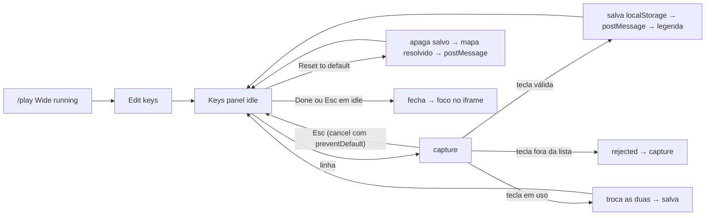

# Design: SF02 Emulator Controls

## TL;DR
Design contract da SF02 do {{doc:0002F}}. Ela encaixa os controles nos espaços que a SF04 ({{doc:0002F-SF04}}, `subfeatures/SF04-console-bezels/design.md`) deixou, sem mudar o tamanho nem a proporção da janela do jogo.
- **Wide:** a linha da legenda mostra a tecla de cada botão do console e o botão "Edit keys". Ele abre o painel "Keys", onde o jogador remapeia e volta ao padrão. O mapa fica salvo no `localStorage` do aparelho.
- **Celular (toque):** um controle virtual próprio do RetroKey aparece no slot `touch-overlay`, com layout por console. Fica nas faixas em volta da janela.
- **Retrato:** uma sugestão de girar o aparelho aparece acima da janela.
- **Tela cheia:** o botão ocupa o slot 44×44 da barra de topo em todo viewport que suporta a API.

O controle embutido do EmulatorJS fica desligado (decisão do dono, epic.md Notes 2026-11-09).

## TOC
- [Screens](#screens)
- [Components](#components)
- [Flows](#flows)
- [Tokens](#tokens)
- [Design Contract](#design-contract)
- [References](#references)
- [Design Review](#design-review)

## Screens
A SF02 não cria rota nem região nova no fluxo. Ela preenche três slots de `/play/[slug]` e abre um diálogo.

**`Wide`** = `(min-width: 1024px) and (pointer: fine)`. **Celular** = fora de `Wide`. **Toque** = `(pointer: coarse)`, a mesma regra do slot `touch-overlay`.

| screen | purpose | primary action | entry |
|---|---|---|---|
| Linha da legenda (`data-slot="legend"`, Wide) | Mostrar a tecla de cada botão do console em uso | nenhuma (Edit keys é secundário) | `/play/[slug]` em Wide |
| Painel Keys (`<dialog>` modal, Wide) | Remapear teclas do console e voltar ao padrão | Done | botão Edit keys da legenda |
| Controle virtual (`data-slot="touch-overlay"`, toque) | Botões do console por toque, com multitoque | nenhuma (controle de jogo) | aparece sozinho com toque, em booting e running |
| Sugestão de girar (toque, retrato) | Sugerir paisagem; não bloqueia | nenhuma (Dismiss é secundário) | aparece sozinha em retrato |
| Tela cheia (`data-slot="fullscreen"`) | Entrar e sair da tela cheia do palco | nenhuma (botão de utilidade) | barra de topo, todo viewport com `document.fullscreenEnabled` |

Layout trees (base mobile 320px; ordem das regiões = ordem no DOM):

```json
{"screen":"play-wide-legend","regions":[{"role":"legend","order":1,"span":{"mobile":"hidden","desktop":"full"},"component":"ControlsLegend","contains":["KeyChip per button or directional set"]},{"role":"action","order":2,"span":{"mobile":"hidden","desktop":"auto"},"component":"ControlsLegend","contains":["edit-keys button"]}]}
{"screen":"keys-panel","regions":[{"role":"header","order":1,"span":{"mobile":"n/a","desktop":"full"},"component":"KeysPanel","contains":["title Keys","console name"]},{"role":"list","order":2,"span":{"mobile":"n/a","desktop":"full"},"component":"KeysPanel","contains":["KeyRow per console button"]},{"role":"status","order":3,"span":{"mobile":"n/a","desktop":"full"},"component":"KeysPanel","contains":["status line"]},{"role":"footer","order":4,"span":{"mobile":"n/a","desktop":"full"},"component":"KeysPanel","contains":["reset-to-default","done"],"primaryCta":"done"}]}
{"screen":"play-phone-portrait","regions":[{"role":"hint","order":1,"span":{"mobile":"full","desktop":"n/a"},"component":"RotateHint","contains":["message","dismiss"]},{"role":"controller","order":2,"span":{"mobile":"full","desktop":"n/a"},"component":"VirtualController","contains":["shoulder row","left cluster","center column","right cluster"]}]}
{"screen":"play-phone-landscape","regions":[{"role":"left","order":1,"span":{"mobile":"side band","desktop":"n/a"},"component":"VirtualController","contains":["left shoulders","left cluster","left center buttons"]},{"role":"right","order":2,"span":{"mobile":"side band","desktop":"n/a"},"component":"VirtualController","contains":["right shoulders","right cluster","right center buttons"]}]}
```

**Botões por console (listas fechadas, base da legenda, do painel e do controle):**

| console | botões |
|---|---|
| NES, Game Boy, Game Boy Color | D-pad, B, A, Select, Start |
| Game Boy Advance | D-pad, B, A, L, R, Select, Start |
| SNES | D-pad, Y, X, B, A, L, R, Select, Start |
| Nintendo 64 | Stick, D-pad, A, B, C-up, C-down, C-left, C-right, Z, L, R, Start |
| Master System, Game Gear | D-pad, 1, 2, Start (rótulo "Pause" no Master System) |
| Mega Drive | D-pad, A, B, C, Start |
| PlayStation | D-pad, Square, Triangle, Cross, Circle, L1, L2, R1, R2, Select, Start |
| Arcade, Neo Geo | Stick (4 direções), A, B, C, D, Coin, Start |

**Linha da legenda (Wide):**
- **Altura:** a mesma linha `h-10` da SF04, no fluxo, depois do `StatusStrip`.
- **Chips:**
  - Um chip por botão. Conjuntos de direção (D-pad, Stick, as quatro C do N64) viram um chip só, com as 4 teclas.
  - Formato do chip: `rótulo` + tampa de tecla, por exemplo `A [X]` e `D-pad [↑ ↓ ← →]`. Select e Start são chips separados.
  - Pior caso: PlayStation com 11 chips e N64 com 9, mais o Edit keys, dentro de 1024px. Nenhum chip pode ser cortado (Design Contract).
- **Edit keys:** fica à direita, `shrink-0`, como botão secundário. Ocupa a altura da linha (40px), com largura mínima de 44px. É um desvio declarado: só existe em Wide, com mouse (C8).

**Painel Keys:**
- **Diálogo:** `<dialog>` nativo, aberto com `showModal()`. Centrado, `max-w-md`, `max-h-[80vh]`. Cabeçalho e rodapé fixos; a lista rola.
- **Superfície:** fundo `--t-bg`, borda 1px `--t-frame`, raio `--t-radius`, padding `p-6`, fundo de trás `bg-black/60`.
- **Linhas:** `KeyRow` com `min-h-11`. O rótulo do botão fica à esquerda; à direita, um botão com a tecla atual.
- **Rodapé:** Reset to default (pill com contorno, secundário) e Done (`ACTION_CLASS`, único primário).

**Controle virtual (toque):**
- **Camada:** o overlay é `pointer-events-none`; só os botões recebem eventos.
- **Margem de baixo:** a altura do `StatusStrip` (`h-8`) mais `env(safe-area-inset-bottom)`. Em paisagem, as margens laterais usam `env(safe-area-inset-left/right)`.
- **Clusters (132px por lado):**
  - D-pad e Stick ocupam uma grade de 3×44px. As 4 zonas do D-pad formam um controle só, então não há folga de 8px entre elas.
  - Face buttons ficam em losango ou par numa grade de 132px.
  - Arcade e Neo Geo: A, B, C, D em grade 2×2 de 44px, com 8px de folga.
- **Gatilhos:** uma linha de 44px acima de cada cluster. No PlayStation, L1 e L2 ficam lado a lado (96px), e R1 e R2 também.
- **Coluna do meio:** entre os clusters, com Select/Start/Pause/Coin empilhados, 44px cada e 8px de folga.
- **N64:** o cluster esquerdo alterna entre Stick e D-pad por um botão "D-pad"/"Stick" de 44px na coluna do meio, acima de Start. O cluster direito usa uma grade 3×3 de 44px: C em losango, A e B nos cantos de baixo. Z fica na linha de gatilhos, no centro.

**Geometria, retrato 390×844:**
- **Posição da janela:** centrada, como na SF04.
- **Onde fica cada peça:** a sugestão de girar vai na faixa de cima; o controle vai na faixa de baixo, alinhado à base.
- **Orçamento de altura:** com gatilhos, 44 + 8 + 132 = 184px; sem gatilhos, 132px.
- **Faixa livre:** (altura do palco − altura da janela) / 2 − 32 − inset de baixo.

| proporção | consoles | gatilhos? | faixa livre sem inset | com inset 34px | cabe |
|---|---|---|---|---|---|
| 4/3 | NES, SNES, N64, SMS, MD, PS, Arcade, Neo Geo | SNES, N64, PS | 222px | 188px | sim (184) |
| 10/9 | GB, GBC, Game Gear | nenhum | 192px | 158px | sim (132) |
| 3/2 | GBA | sim | 238px | 204px | sim (184) |

**Geometria, paisagem 844×390:**
- **Faixas laterais:** a janela ocupa a altura do palco, e os clusters ficam nas faixas dos lados. Em 4/3, cada faixa tem 191px (147px com inset de 44px no lado do notch); 10/9 tem 230px; 3/2 tem 162px.
- **Faixa estreita:** se a faixa for mais estreita que 132px, o cluster pode avançar no máximo 24px sobre a borda da janela.
  - Nessa parte, o botão tem fundo `--t-bg` com opacidade 0.8 e contorno de 2px em `--t-accent`.
  - Ele nunca entra além de 24px.
- **Gatilhos e meio:** os gatilhos ficam no topo de cada faixa. Os botões da coluna do meio se dividem: Select (ou Coin) embaixo do cluster esquerdo, Start embaixo do direito. No N64, o botão D-pad/Stick fica embaixo do cluster esquerdo.

**Sugestão de girar:**
- **Forma:** pill com `min-h-11`, `text-sm` em `--t-text` sobre `--t-bg`, borda 1px `--t-accent`.
- **Texto e ação:** "Turn your phone sideways for a bigger game." e botão "Dismiss" (44×44).
- **Posição:** centrada na faixa de cima, em retrato. Some em paisagem. O dismiss vale para a sessão.

**Estados:**

| play state | legenda (Wide) | controle virtual (toque) | sugestão de girar (retrato) | tela cheia |
|---|---|---|---|---|
| loading-metadata, not-found, metadata-error, failed | linha reservada, vazia | oculto | oculta | visível |
| booting | chips visíveis, Edit keys `aria-disabled` | visível, inerte (`aria-disabled`) | visível | visível |
| running | chips e Edit keys ativos | ativo | visível até dispensar ou girar | visível |

**Estados do painel Keys:**

| state | when | UI |
|---|---|---|
| idle | painel aberto | linhas com a tecla atual; Reset desabilitado sem mapa salvo |
| capture | clique numa linha | linha em `--t-accent`; status "Press a key for {botão}. Esc cancels." |
| rejected | tecla fora da lista fechada (Tab, F1-F12, modificadores sozinhos); Escape não entra aqui, ele cancela a captura e volta a idle | status "That key can't be used. Pick another."; captura continua |
| swapped | tecla já usada por outro botão | as duas trocam; status "{tecla} was on {outro}; swapped." |
| saved | tecla aceita | status "Saved."; legenda atualiza |
| reset | Reset to default | mapa salvo apagado; status "Default keys restored."; Reset desabilitado |
| no-storage | `localStorage` lança | status "Keys can't be saved in this browser."; o mapa vale na sessão |

## Components
Cinco componentes novos; três existentes mudam só para montar os novos nos slots.

- `ControlsLegend` — new, `components/ControlsLegend.tsx` — props: `consoleId`, `map` (mapa resolvido), `status: PlayScreenState`, `onEdit(): void` — estados: vazio, booting, running — composed-of: [KeyChip, edit-keys button]
- `KeysPanel` — new, `components/KeysPanel.tsx` — props: `consoleId`, `map`, `hasSaved: boolean`, `storageOk: boolean`, `open: boolean`, `onRemap(button, code)`, `onReset()`, `onClose()` — estados: idle, capture, rejected, swapped, saved, reset, no-storage — composed-of: [dialog, KeyRow, status line, reset button, done button]
- `VirtualController` — new, `components/VirtualController.tsx` — props: `consoleId`, `status: PlayScreenState`, `onInput(button, pressed: boolean)` — estados: oculto, inerte, ativo, pressionado por botão; N64: stick ou d-pad — composed-of: [DPad, Stick, TouchButton, RotateHint]
- `RotateHint` — new, `components/RotateHint.tsx` — props: `onDismiss()` — estados: visível, dispensada — composed-of: [message, dismiss button]
- `FullscreenToggle` — new, `components/FullscreenToggle.tsx` — props: `targetRef` (elemento `play-stage`) — estados: off, on, sem suporte (oculto) — composed-of: [icon button]
- `PlayStage` — existing — monta `ControlsLegend` no slot `legend`, `VirtualController` no slot `touch-overlay`, `KeysPanel` e `FullscreenToggle`; tamanho do palco e da janela sem mudança — composed-of: [PlayTopBar, ThemedFrame, StatusStrip, ControlsLegend, VirtualController, KeysPanel]
- `PlayTopBar` — existing — recebe `FullscreenToggle` como `children` do slot `fullscreen`; sem outra mudança — composed-of: [next/link, h1, system label, FullscreenToggle]
- `Emulator` — existing — envia o mapa e o input ao iframe; nenhuma mudança visual — composed-of: [iframe]

Pressed e rest dos botões de toque:
- **Rest:** fundo `--t-bg` com opacidade 0.6 e contorno de 2px em `--t-accent`, com rótulo `text-sm` semibold em `--t-text`.
- **Pressed:** fundo `--t-accent` com rótulo `#18181B`, sem transição.

## Flows
Cinco fluxos: remapear, voltar ao padrão, jogar por toque, tela cheia e mapa na carga.



- **Mapa na carga:** a cada `EMULATOR_CANVAS_READY` (inclui nova tentativa de core e Reload), o mapa é resolvido: salvo válido > mapa do console. Depois vai ao iframe por `postMessage`. Ida e volta conferem origem e janela (RN03).
- **Painel aberto:** foco preso no `<dialog>`. As teclas não chegam ao jogo. O jogo não é pausado (a pausa não foi verificada no EmulatorJS).
- **Fechar o painel:**
  - Done ativa no `click`.
  - O foco vai para `iframe.contentWindow.focus()` no frame seguinte ao `keyup`, então o Enter do Done não chega ao jogo como Start.
  - Sem iframe, o foco volta ao Edit keys.
- **Toque:**
  - `pointerdown` em um botão → `onInput(botão, true)` → `pointerup` → `onInput(botão, false)`.
  - O D-pad usa pointer capture, e deslizar troca a direção.
  - Em `pointercancel`, `blur`, `visibilitychange` e `orientationchange`, todos os botões são soltos.
  - Um clique sintético (leitor de tela) pressiona e solta em 100 ms.
- **Tela cheia:**
  - Toque → `requestFullscreen()` no `play-stage` → tenta `screen.orientation.lock('landscape')` em `try/catch`.
  - `fullscreenchange` sincroniza `aria-pressed` e o rótulo "Full screen"/"Exit full screen".
  - Se o pedido é recusado, o botão fica desligado, sem mensagem.
- **Desktop estreito (< 1024px, mouse):** sem legenda, sem painel e sem controle virtual. O teclado funciona com o mapa resolvido, e a tela cheia funciona. É a regra D10 da SF04, mantida.

## Tokens
A SF02 não cria custom property nova. Usa os 7 tokens do palco e `#18181B` sobre `--t-accent`.

```json
{"cluster":{"size":"132px","cell":"44px","dpadGap":"0","buttonGap":"8px"},"shoulderRow":"44px","centerColumn":{"button":"44px","gap":"8px"},"portraitBudget":{"withShoulders":"184px","withoutShoulders":"132px"},"landscapeOverlapMax":"24px","touchRest":{"bg":"--t-bg","opacity":0.6,"outline":"2px --t-accent","label":"--t-text text-sm semibold"},"touchOverlap":{"bg":"--t-bg","opacity":0.8,"outline":"2px --t-accent"},"touchPressed":{"bg":"--t-accent","label":"#18181B","transition":"none"},"legend":{"row":"h-10","chip":"text-xs --t-text","keycap":"1px --t-muted border, --t-text","editKeys":"h-10 min-w-11, secondary"},"keysPanel":{"bg":"--t-bg","border":"1px --t-frame","radius":"--t-radius","padding":"p-6","maxW":"max-w-md","maxH":"80vh","backdrop":"bg-black/60","row":"min-h-11 text-sm","title":"text-lg semibold"},"rotateHint":{"minH":"min-h-11","text":"text-sm --t-text","bg":"--t-bg","border":"1px --t-accent"},"bottomReserve":"h-8 + env(safe-area-inset-bottom)"}
```

## Design Contract
O QA verifica os compromissos abaixo. Os valores vêm do `design-context` (tokens `--t-*` da SF01 e regras da SF04) e da tabela Tokens.

| Dimension | Declares | Verified by | Method |
|---|---|---|---|
| Layout stability | A caixa da janela do jogo é igual (0px) com e sem a SF02 montada, em 390×844, 844×390 e 1366×768; o painel Keys, a legenda, o controle e a sugestão não mudam a caixa | Computed style | `getBoundingClientRect` de `[data-window]` antes e depois de abrir painel, girar e dispensar a sugestão |
| Spacing scale | Passos 1, 2, 3, 4, 6, 8; 8px entre alvos de toque; desvio: 0px entre as 4 zonas do D-pad (um controle só) | Computed style | gap/padding vs conjunto de passos |
| Token allowlist | `--t-bg`, `--t-accent`, `--t-frame`, `--t-text`, `--t-muted`, `--t-ar`, `--t-radius`, `#18181B` sobre accent, `bg-black/60` no fundo do diálogo; nenhuma custom property nova | Computed style | custom properties resolvidas e cores computadas |
| Typographic scale | Chips `text-xs`; título do painel `text-lg` semibold; linhas, botões, sugestão e rótulos de toque `text-sm`; família `unknown` — o projeto não define fonte | Computed style | font-size e weight |
| Minimum tap target | 44×44px em todo alvo de toque (botões do controle, D-pad por zona, Dismiss, tela cheia, linhas e botões do painel); desvio: Edit keys 40px de altura × ≥44px, só em Wide (mouse) | axe-core (`target-size`) + computed style | axe + bounding box ≥44px em E2E |
| Contrast target | Texto ≥ 4,5:1 (chips, painel, sugestão, rótulos de toque sobre `--t-bg`); UI ≥ 3:1 (contorno `--t-accent` sobre `--t-bg`) nos 12 temas | axe-core (`color-contrast`) | Regra determinística |
| Controller fit | Em 390×844, o controle cabe na faixa de baixo nos 12 consoles: nenhum botão sobre a janela, nenhum sobre o `StatusStrip`; em 844×390, nenhum botão avança mais de 24px sobre a janela | Computed style | Interseção dos retângulos de cada botão com `[data-window]` e com o strip |
| Legend fit | Em 1024×768 e 1366×768, nenhum chip cortado nos 12 consoles; Edit keys visível | Computed style | `scrollWidth ≤ clientWidth` da linha; retângulo de cada chip dentro da linha |
| Breakpoint behaviour | Wide: legenda + painel; toque: controle; retrato com toque: sugestão; paisagem 844×390: sem sugestão; abaixo de Wide com mouse: sem legenda e sem controle (aceito); tela cheia em todo viewport com suporte | Screenshot + computed style | presença e visibilidade por viewport |
| Required states | Legenda: vazio, booting, running; painel: idle, capture, rejected, swapped, saved, reset, no-storage; controle: oculto, inerte, ativo, pressed; N64 stick/d-pad; sugestão: visível, dispensada; tela cheia: off, on | Evidence set | Comparação dos arquivos de estado capturados |
| Primary CTA count | Painel Keys: 1 (Done); legenda: 0 (Edit keys secundário); celular: 0 (controle e Dismiss não são CTA); estados da SF04 sem mudança | Screenshot | Juízo do agente |
| Motion | Pressed sem transição; nenhuma animação nova; `prefers-reduced-motion` sem efeito a desligar | Computed style | `transition-duration` 0s nos botões de toque |
| Accessibility | axe sem violações com o painel aberto (idle e capture), com a legenda em running e com o controle em running; `<dialog>` com `aria-labelledby`; status do painel `role="status"`; botões de toque com nome acessível do botão do console; tela cheia com `aria-pressed`; foco visível em `--t-accent` | axe-core | Regras determinísticas |
| Focus return | Depois de Done ou Esc, `document.activeElement` é o iframe e o Enter do Done não chega ao jogo | E2E | stub do `/emulator.html` registra mensagens de input recebidas |

## References
- {{doc:0002F-SF04}}: contrato de layout atual da tela de jogo (slots, `Wide`, StatusStrip, D10) — `subfeatures/SF04-console-bezels/design.md`.
- {{doc:0002F-SF01}}: tokens `--t-*`, `ACTION_CLASS` e estados da tela de jogo — `subfeatures/SF01-play-screen-themes/design.md`.
- `docs/features/0002F-emulator-themes-controls/epic.md` Notes, 2026-11-09: controle virtual como camada própria do RetroKey.
- `.codeadd/wiki/domains/frontend.md` (Styling): vocabulário zinc/cyan; página desatualizada nas fontes, verificada contra o código.
- Fonte de estilo: o ui-ux-pro-max não rodou, porque `python3`/`py` aqui são só o alias da Windows Store. Foram usados os tokens inspecionados e os padrões do `add--ux-design`.

## Design Review
Os 10 itens da crítica do @ux-agent (modo crítica) e os pontos abertos do @ux-flow-agent e do @ux-layout-agent, com a decisão de cada um.

| Item | Severity | Decision | Rationale |
|---|---|---|---|
| C1 — faixa de baixo em retrato não comporta o modelo de zonas | blocker | accepted | Clusters de 132px, uma linha de gatilhos, coluna do meio entre os clusters e alternância Stick/D-pad no N64; orçamento 184px contra 188px no pior caso (4/3, inset 34px); dimensão Controller fit no contrato |
| C2 — desktop estreito e híbridos sem legenda nem painel | major | rejected | Legenda só em `Wide` é regra fechada da SF04 (D10) mantida pelo dono nesta rodada; o slot de toque segue `pointer: coarse` desde a SF01; o teclado padrão funciona; registrado em Flows e Breakpoint behaviour |
| C3 — sobreposição em paisagem sem medida | major | accepted | Máximo de 24px sobre a janela, fundo `--t-bg` 0.8 com contorno 2px `--t-accent`; medido em Controller fit |
| C4 — chips agrupados mal definidos | major | accepted | Um chip por botão; só conjuntos de direção viram um chip; formato rótulo + tampa de tecla; Select e Start separados; Legend fit no contrato |
| C5 — contagem de CTA primário contraditória | major | accepted | Edit keys e Dismiss secundários; legenda 0, celular 0, painel 1 (Done) |
| C6 — foco no iframe pode falhar | major | accepted | `contentWindow.focus()` no frame seguinte ao `keyup`; Esc em capture com `cancel` + `preventDefault`; sem iframe, foco no Edit keys; Tab e Escape fora da lista de teclas; Focus return no contrato |
| C7 — estados faltando | minor | accepted | Estado rejected no painel; tela cheia recusada fica desligada sem mensagem; o jogo não pausa com o painel aberto (declarado) |
| C8 — Edit keys sobrando 4px sobre o strip | minor | accepted (com ajuste) | Sem sobra: Edit keys ocupa a linha de 40px com largura ≥44px; desvio declarado porque só existe em `Wide` com mouse; linha e palco sem mudança |
| C9 — tamanhos e superfícies sem valor | minor | accepted | Valores em Tokens: KeyRow `min-h-11`, superfície do diálogo, fundo `bg-black/60`, `max-h` 80vh, pill da sugestão, cor do chip, exceção de folga do D-pad |
| C10 — tela cheia escondida em Wide | polish | accepted | O slot 44×44 já existe em todos os viewports; em Wide a tela cheia esconde a barra do navegador e amplia o palco; oculto só sem `document.fullscreenEnabled` |
| Fluxo — Save explícito no painel | — | rejected | Cada tecla aceita salva na hora; um Save a mais não protege nada, porque Reset volta ao padrão |
| Fluxo — mapa reenviado a cada `EMULATOR_CANVAS_READY` | — | accepted | Cobre nova tentativa de core e Reload sem estado extra |
| Layout — legenda de 40px vs alvo de 44px | — | changed | Resolvido por C8 |
| Layout — N64 abaixo de 370px como `unknown` | — | changed | Substituído pela alternância Stick/D-pad e pelo orçamento de C1 |
