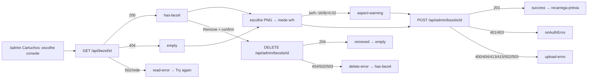

# Design: SF04 Console Bezels

## TL;DR
Design contract da SF04 do {{doc:0002F}}. Ele parte do contrato da SF01 ({{doc:0002F-SF01}}, `subfeatures/SF01-play-screen-themes/design.md`) e muda três coisas. Primeiro, em telas largas com mouse (`Wide`), um bezel PNG por console aparece atrás do jogo numa área 16:9. Segundo, fora de `Wide` (celular, retrato ou paisagem) o jogo fica sem bezel e sem moldura CSS, na maior área possível. Terceiro, a aba Cartuchos do admin ganha o bloco "Bezel por console". Os seis estados da SF01 e os espaços da SF02 continuam. O contrato também fecha os achados QA-04, QA-08, QA-10, QA-11, QA-12, QA-13 do review-001.

## TOC
- [Screens](#screens)
- [Components](#components)
- [Flows](#flows)
- [Tokens](#tokens)
- [Design Contract](#design-contract)
- [References](#references)
- [Design Review](#design-review)

## Screens
A SF04 não cria rota nova. Ela muda `/play/[slug]` em três ramos e acrescenta um bloco à aba Cartuchos de `/admin`.

**`Wide`** = a media query `(min-width: 1024px) and (pointer: fine)`. **Celular** = qualquer viewport fora de `Wide`. Isso inclui 844×390 com mouse (o viewport do E2E) e uma janela de desktop com menos de 1024px de largura.

| screen | purpose | primary action | entry |
|---|---|---|---|
| `/play/[slug]` Wide + bezel | Jogo dentro da arte do console | Por estado (tabela de estados da SF01; Back home da barra não é primário) | `/`, `/rooms/[slug]`, `/nfc/[id]`, URL |
| `/play/[slug]` Wide sem bezel | Moldura CSS da SF01, sem mudança | Por estado | mesmo |
| `/play/[slug]` celular (390×844, 844×390) | Jogo na maior área, sem moldura, sem rolagem | Por estado | mesmo |
| `/admin` → aba Cartuchos → "Bezel por console" | Ver, enviar e remover o bezel de um console | Upload bezel | login admin → aba Cartuchos |

Layout trees (base mobile 320px). Ordem das regiões = ordem no DOM:

```json
{"screen":"play-wide-bezel","regions":[{"role":"header","order":1,"span":{"mobile":"full","desktop":"full"},"component":"PlayTopBar","contains":["back-link","game-title","system-label","fullscreen-slot"]},{"role":"stage","order":2,"span":{"mobile":"full","desktop":"full"},"component":"ThemedFrame","contains":["bezel-area","PlayBezel","game-window","Emulator","state-panel"],"primaryCta":"state-panel action"},{"role":"status","order":3,"span":{"mobile":"overlay","desktop":"full"},"component":"StatusStrip","contains":["status-text"]},{"role":"legend","order":4,"span":{"mobile":"hidden","desktop":"full"},"component":"legend-slot","contains":["SF02 key legend"]}]}
{"screen":"play-wide-no-bezel","regions":[{"role":"header","order":1,"span":{"mobile":"full","desktop":"full"},"component":"PlayTopBar","contains":["back-link","game-title","system-label","fullscreen-slot"]},{"role":"stage","order":2,"span":{"mobile":"full","desktop":"full"},"component":"ThemedFrame","contains":["data-frame","Emulator","state-panel"],"primaryCta":"state-panel action"},{"role":"status","order":3,"span":{"mobile":"overlay","desktop":"full"},"component":"StatusStrip","contains":["status-text"]},{"role":"legend","order":4,"span":{"mobile":"hidden","desktop":"full"},"component":"legend-slot","contains":["SF02 key legend"]}]}
{"screen":"play-phone","regions":[{"role":"header","order":1,"span":{"mobile":"full","desktop":"n/a"},"component":"PlayTopBar","contains":["back-link","game-title"]},{"role":"stage","order":2,"span":{"mobile":"full","desktop":"n/a"},"component":"ThemedFrame","contains":["game-window","Emulator","state-panel"],"primaryCta":"state-panel action"},{"role":"overlay","order":3,"span":{"mobile":"full","desktop":"n/a"},"component":"touch-overlay-slot","contains":["SF02 virtual controller"]},{"role":"status","order":4,"span":{"mobile":"overlay","desktop":"n/a"},"component":"StatusStrip","contains":["status-text"]}]}
{"screen":"admin-bezels-block","regions":[{"role":"form","order":1,"span":{"mobile":"full","desktop":"full"},"component":"BezelsSection","contains":["console-select","current-bezel-preview","remove-bezel","read-retry","png-file-input","new-file-preview","aspect-warning","upload-bezel","feedback"],"primaryCta":"upload-bezel"}]}
```

**PlayTopBar no celular:** a barra fica com Back home, o título e o `fullscreen-slot`. O rótulo do sistema some (QA-12). O título fica em `text-lg`, numa linha só, com reticências. A barra tem a altura do alvo de 44px.

**Wide + bezel, geometria:**
- **Palco:** o espaço entre a barra de topo e as linhas de status e legenda.
- **Área 16:9:** o maior retângulo 16:9 que cabe no palco, centrado nos dois eixos.
- **Faixas que sobram:** à esquerda e à direita em 1366×768, ou em cima e embaixo numa janela alta. Mostram `--t-bg`.
- **Imagem do bezel:** preenche a área 16:9 (`object-fit: fill`).
- **Janela do jogo:** o maior retângulo na proporção do console (`--t-ar`) com 100% da altura da área, centrado na horizontal. Fica por cima da imagem e por baixo do `state-panel`. Não tem `[data-frame]`, borda nem raio.
- **Em 1920×1080 (área 1920×1080):** janela 1440×1080 (4/3), 1200×1080 (10/9) ou 1620×1080 (3/2).

**Celular, geometria:** a janela do jogo é o maior retângulo em `--t-ar` dentro de todo o palco abaixo da barra. Fica centrada, sem `[data-frame]`, sem borda e sem padding. A página não rola (`scrollHeight ≤ innerHeight`).

**StatusStrip no celular:**
- **Posição:** faixa `absolute`, colada na borda de baixo do palco. Altura `h-8`, fundo `--t-bg` sólido, texto `--t-text`.
- **Camadas e eventos:** `pointer-events-none`, abaixo do `touch-overlay-slot` na ordem de camadas.
- **Running:** o texto fica visualmente oculto (`sr-only`), mas o nó com `role="status"` continua montado.
- **Demais estados:** a faixa aparece, incluindo os estados de erro.
- **Efeito no quadro:** fora do fluxo, então nunca muda o tamanho da janela do jogo.

**StatusStrip em `Wide`:** linha `h-8` no fluxo, igual à SF01.

**Linha da legenda:** aparece só em `Wide`, então abaixo de 1024px não há legenda. A SF02 fica com essa regra.

**Skeleton (loading-metadata, QA-13):** uma caixa 4/3 centrada no palco, com a mesma regra de tamanho da janela final. O console ainda é desconhecido durante o carregamento; 4/3 é a proporção de 9 dos 12 consoles.

**Estados (os seis da SF01 continuam; mudam as linhas abaixo):**

| state | Wide + bezel | Wide sem bezel | celular | primary CTA |
|---|---|---|---|---|
| loading-metadata | skeleton 4/3 | skeleton 4/3 | skeleton 4/3, faixa de status visível | — |
| not-found | tema `neutral`, sem bezel | painel no `[data-frame]` | painel na janela | **Back home** (botão no painel, novo, QA-08) |
| metadata-error | sem bezel (sistema desconhecido) | painel | painel | Retry |
| booting | moldura CSS até o bezel carregar; troca única para o bezel | moldura CSS | janela sem moldura | — |
| running | bezel fixo; troca bloqueada | moldura CSS | janela; texto de status `sr-only` | — |
| failed | painel na janela | painel | painel | Reload |

O link Back home da barra de topo é navegação secundária em todos os estados (link de texto). O botão primário fica no painel do estado. Retry, Reload e Back home do painel usam a mesma classe, com `px-6` (QA-04).

**Estados do bloco admin:**

| state | when | UI | next |
|---|---|---|---|
| checking | console escolhido; `GET /api/bezel/<id>` em andamento | prévia atual em skeleton 16:9 (`motion-safe:animate-pulse`); controles habilitados; resposta de console antigo é ignorada | empty / has-bezel / read-error |
| empty | GET 404 | "No bezel for this console yet."; Remove desabilitado | file-selected |
| has-bezel | GET 200 | prévia atual sobre xadrez zinc-900/zinc-800, caixa 16:9; Remove habilitado | file-selected / removing |
| read-error | GET 502 ou rede | "Could not read this bezel." + botão "Try again" (min-h-11); envio continua permitido | checking |
| file-selected | PNG escolhido | prévia nova (object URL) rotulada "New file", abaixo do input; prévia atual continua visível; mede largura e altura naturais; Upload habilitado | aspect-warning / uploading |
| aspect-warning | `abs(w/h − 16/9) > 0.02` | amber-300, `role="status"`: "This image is W×H, not 16:9. It will be stretched to 16:9 on the play screen. You can still upload."; Upload habilitado | uploading |
| uploading | POST em andamento | "Uploading..."; select, arquivo, Upload e Remove desabilitados | success / upload-error |
| success | 201 | cyan-400, `role="status"`: "Bezel saved for {console}."; input limpo; prévia atual recarregada com `?v=<timestamp>` | has-bezel |
| upload-error | POST ≠ 201 | red-400, `role="alert"`, texto por status; arquivo mantido | file-selected |
| removing | DELETE em andamento (após `confirm()`) | "Removing..."; todos os controles desabilitados | removed / delete-error |
| removed | 204 | "Bezel removed for {console}."; prévia → empty | empty |
| delete-error | DELETE ≠ 204 | red-400, `role="alert"`, texto por status | has-bezel |

Textos de erro. 401 e 403 chamam o `onAuthError` existente, em envio e remoção.

| status | envio (POST) | remoção (DELETE) |
|---|---|---|
| 404 | "Unknown console." | "This console has no bezel." |
| 400 | "Choose a PNG file first." | — |
| 415 | "This file is not a PNG." | — |
| 413 | "File is over 2 MB." | — |
| 503 | "Storage is not configured. Nothing was saved." | mesmo texto |
| 502 | "Storage failed. Nothing was saved. Try again." | mesmo texto |
| rede | "Could not reach the server." | mesmo texto |

## Components
Dois componentes novos, um hook novo e cinco componentes alterados; o `Emulator` só muda o tipo do callback (CR-3).

- `PlayBezel` — new, `components/PlayBezel.tsx` — props: `consoleId: string`, `onLoaded(): void`, `onFailed(): void` — estados: pending, loaded, failed — `" alt="" aria-hidden="true">` com `object-fit: fill`; só é montado quando `useWideScreen()` é `true`, o console é conhecido e o bezel ainda não foi recusado — composed-of: [img]
- `useWideScreen` — new, `components/useWideScreen.ts` — retorna `boolean` de `matchMedia('(min-width: 1024px) and (pointer: fine)')` com listener de `change`; `false` no primeiro render (sem diferença de hidratação) — composed-of: []
- `BezelsSection` — new, `components/admin/BezelsSection.tsx` — props: `onAuthError(): void` — estados: os 12 da tabela do bloco admin — cartão `rounded-2xl p-6` como `CartridgesTab`; select com os 12 consoles (rótulo de `systemOptions`, valor = id de moldura); input de arquivo dentro de um `label` com estilo de botão (min-h-11); Upload (cyan-500, único primário); Remove (texto red-400, `confirm()` como o Delete de cartucho); linha de feedback logo abaixo do Upload — composed-of: [select, label+input file, img (prévia atual), img (prévia nova), button Upload, button Remove, button Try again, feedback]
- `CartridgesTab` — existing, `components/admin/CartridgesTab.tsx` — monta `<BezelsSection onAuthError={onAuthError} />` entre o cartão "Create new cartridge" e o cartão da lista; formulário de cartucho sem mudança — composed-of: [BezelsSection]
- `PlayStage` — existing, `components/PlayStage.tsx` — novo estado `bezel: 'none' | 'pending' | 'adopted' | 'refused'`; `wide = useWideScreen()`; renderiza `PlayBezel` dentro do `ThemedFrame` quando `wide && ready`; adota o bezel só se `onLoaded` chega antes de `running`; legenda só em `Wide`; status com o tipo `EmulatorStatus` (CR-3); `getCoreForSystem` só com metadados ok (CR-2); sem o ramo inalcançável `metaState === 'ok' ? 'loading'` (CR-1) — composed-of: [PlayTopBar, ThemedFrame, PlayBezel, StatusStrip, Emulator]
- `ThemedFrame` — existing, `components/ThemedFrame.tsx` — modos: `frame` (Wide sem bezel, `[data-frame]` da SF01), `bezel` (Wide com bezel adotado: área 16:9 + janela, sem `[data-frame]`), `bare` (celular: janela sem moldura); no CSS, o modo celular vale fora da media `Wide`, então o tamanho segue a media mesmo antes da hidratação; skeleton 4/3; painel not-found com Back home; `ACTION_CLASS` com `px-6` — composed-of: [StatePanel, children]
- `StatusStrip` — existing, `components/StatusStrip.tsx` — linha `h-8` em `Wide`; faixa sobreposta no celular; texto `sr-only` em running no celular — composed-of: []
- `PlayTopBar` — existing, `components/PlayTopBar.tsx` — título `text-lg`, `text-2xl` só na variante `Wide`; rótulo do sistema oculto fora de `Wide`; Back home é link de texto (secundário) — composed-of: [next/link, h1, system label, fullscreen-slot]

## Flows
Três fluxos: admin envia, jogador abre em `Wide`, jogador abre no celular.



- Jogador em `Wide`: `/play/{slug}` → metadados 200 → `Emulator` monta (booting) e `PlayBezel` monta ao mesmo tempo → a imagem carrega antes de `running` → troca única para o modo bezel. Se a imagem dá 404, 502, erro ou chega depois de `running`, fica a moldura CSS, sem mensagem e sem mudar o status.
- Jogador no celular: `/play/{slug}` → metadados 200 → `Emulator` monta no modo `bare` → nenhum pedido de bezel.
- Redimensionar a janela: cruzar 1024px muda o modo pelo CSS. Saindo de `Wide`, a janela volta a `bare` e a legenda some. Entrando em `Wide` depois de `running`, fica a moldura CSS, porque a adoção está bloqueada. A mudança de tamanho vem da ação do usuário, não de carga de rede.
- Os fluxos de estado da SF01 (Retry, Reload, Back home) não mudam. Reload remonta só o `Emulator` e mantém o modo de bezel já decidido.

## Tokens
A SF04 não cria custom property de tema nova. No admin, a única cor nova é o amber-300 do aviso de proporção.

```json
{"wide":{"media":"(min-width: 1024px) and (pointer: fine)"},"bezelArea":{"ratio":"16/9","fit":"fill","bands":"--t-bg","centered":"both axes"},"gameWindow":{"wideBezel":"height 100% of area, width = height × --t-ar, centered x","phone":"largest --t-ar box in stage, centered"},"skeleton":{"ratio":"4/3"},"phoneStatus":{"height":"h-8","bg":"--t-bg","text":"--t-text","position":"absolute bottom, pointer-events none"},"admin":{"warning":"amber-300","success":"cyan-400","error":"red-400","preview":{"ratio":"16/9","checker":["zinc-900","zinc-800"]},"maxBytes":2097152,"aspectTolerance":0.02},"actionPaddingX":"px-6"}
```

## Design Contract
O QA verifica os compromissos abaixo. Os valores vêm do `design-context` (zinc/cyan e os `--t-*` da SF01) e da tabela Tokens.

| Dimension | Declares | Verified by | Method |
|---|---|---|---|
| Spacing scale | Passos 1, 2, 3, 4, 6, 8; Retry, Reload e Back home do painel com `px-6` (QA-04); admin `p-6`, `gap-4`; desvio herdado da SF01: espessura da moldura `clamp(8px, 1.5vmin, 20px)` | Computed style | Gap/padding capturados vs conjunto de passos |
| Token allowlist | Palco: `--t-bg`, `--t-accent`, `--t-frame`, `--t-text`, `--t-muted`, `--t-ar`, `--t-radius`; faixas do bezel e faixa de status no celular em `--t-bg`; admin: zinc-950/900/800/700, cyan-500/400, red-400/300, amber-300 | Computed style | Custom properties resolvidas e cores computadas |
| Contrast target | Texto ≥ 4,5:1 (status no celular sobre `--t-bg`; amber-300, cyan-400 e red-400 sobre zinc-900); UI ≥ 3:1 | axe-core (`color-contrast`) | Regra determinística |
| Minimum tap target | 44px com 8px entre alvos: Back home, Retry, Reload, Back home do painel, fullscreen-slot, select de console, label do arquivo, Upload, Remove, Try again | axe-core (`target-size`) | Regra determinística |
| Typographic scale | Título `text-lg` fora de `Wide` (inclui 844×390; nunca `text-base`, QA-10), `text-2xl` em `Wide`, semibold, uma linha com reticências; rótulo do sistema `text-xs` só em `Wide`; status `text-sm`, `text-xs` em running; família `unknown` — o projeto não define fonte | Computed style | font-size capturado em 390×844, 844×390, 1366×768 |
| Bezel geometry | Wide + bezel: área com razão 16:9 (±1px), centrada nos dois eixos no palco (±2px); janela com altura = altura da área (±1px), centrada na horizontal (±2px), razão = `--t-ar` (±0,01); nenhum `[data-frame]` no ramo | Computed style | `getBoundingClientRect` da área e da janela em 1366×768 e 1920×1080 |
| Breakpoint behaviour | 390×844 e 844×390 (com mouse ou toque): sem bezel, sem `[data-frame]`, janela na maior caixa em `--t-ar`, sem rolagem, sem legenda, sem pedido a `/api/bezel/**`; 1366×768 e 1920×1080: bezel se existir, senão moldura CSS da SF01; abaixo de 1024px não há legenda (aceito) | Screenshot + computed style + network log | `scrollHeight ≤ innerHeight`; contagem de pedidos `/api/bezel/**` |
| Layout stability | Skeleton 4/3 segue a regra de tamanho da janela; em `Wide` a caixa da janela muda no máximo uma vez (moldura → bezel), só em booting; depois de `running` a caixa não muda (0px); faixa de status no celular não move a janela | Computed style | Caixa da janela capturada em loading, booting, running |
| Bezel never blocks | Bezel 404, 500 ou com 3 s de atraso: o jogo chega a `running` e fica a moldura CSS; nenhum texto de erro do bezel | E2E | `page.route` em `/api/bezel/**` + stub de `/emulator.html` |
| Required states | Play: loading-metadata, not-found, metadata-error, booting, running, failed; bezel: adopted, refused; admin: checking, empty, has-bezel, read-error, file-selected, aspect-warning, uploading, success, upload-error, removing, removed, delete-error | Evidence set | Comparação dos arquivos de estado capturados |
| Primary CTA count | No máximo 1 por estado: Back home do painel (not-found), Retry (metadata-error), Reload (failed), nenhum em loading/booting/running; Back home da barra é link de texto; admin: Upload | Screenshot | Juízo do agente |
| Motion | Pulse do skeleton só com `motion-safe:`; troca moldura → bezel sem animação; `prefers-reduced-motion: reduce` desliga o pulse | Computed style | `animation-name` com reduce emulado |
| Accessibility | axe sem violações em loading-metadata (QA-11), not-found, booting, running, failed e no bloco admin; bezel `alt=""` + `aria-hidden`; status com `role="status"` montado em todos os estados; erros com `role="alert"`; foco visível | axe-core | Regras determinísticas |

## References
- {{doc:0002F-SF01}}: o contrato de layout, estados, tokens e espaços da SF02 que esta SF altera (`subfeatures/SF01-play-screen-themes/design.md`).
- `docs/features/0002F-emulator-themes-controls/review-001.md`: achados QA-04, QA-08, QA-10, QA-11, QA-12, QA-13 fechados por este contrato. QA-01, 02, 03, 05, 06 e 07 continuam abertos só para `Wide` sem bezel.
- `docs/features/0002F-emulator-themes-controls/subfeatures/SF02-emulator-controls/about.md`: a legenda, o controle virtual e a tela cheia usam os espaços mantidos aqui. A legenda passa a aparecer só em `Wide`.
- `.codeadd/wiki/domains/frontend.md` (Styling): vocabulário zinc/cyan. Página desatualizada nas fontes; verificada contra o código.
- Fonte de estilo: o ui-ux-pro-max não rodou, porque `python3`/`python` aqui são só o alias da Windows Store. Foram usados os tokens inspecionados e os padrões do `add--ux-design`.

## Design Review
Os 16 itens da crítica do @ux-agent (modo crítica) e as 3 perguntas do @ux-layout-agent, com a decisão de cada um.

| Item | Severity | Decision | Rationale |
|---|---|---|---|
| D1 — faixa de status no celular sem fundo nem contraste | major | accepted | Fundo `--t-bg` sólido, texto `--t-text`, `h-8`, `pointer-events-none`, abaixo do touch-overlay; visível nos erros, como pede o RF05 |
| D2 — `sm:text-2xl` vale em 844×390 | major | accepted | `text-lg` fora de `Wide`, `text-2xl` só na variante `Wide`; sai `[@media(max-height:480px)]:text-base` |
| D3 — `Wide` detectado de dois jeitos | major | accepted | Layout por media no CSS; `useWideScreen` (matchMedia) só decide montar `PlayBezel`; regra de redimensionar definida em Flows |
| D4 — dois CTAs primários por estado | major | accepted | Back home da barra é link de texto; o primário fica no painel; not-found ganha botão Back home no painel |
| D5 — posição vertical e faixas da área 16:9 | major | accepted | Área centrada nos dois eixos; faixas em `--t-bg`; medida vertical no contrato |
| D6 — troca moldura → bezel durante o boot | major | accepted (com ajuste) | Recusado segurar o skeleton ou o iframe até o bezel: RN04 proíbe atrasar o jogo. Aceito: uma troca só, em booting, declarada em Layout stability; `PlayBezel` monta junto com o `Emulator`; o E2E controla o tempo do stub de `/emulator.html` |
| D7 — estados do admin incompletos no contrato | minor | accepted | Os 12 estados estão na tabela e em Required states, com upload-error e delete-error separados |
| D8 — ação "Dismiss" sem UI; "Reload preview" sem ação | minor | accepted | Sem dismiss (o aviso some com novo arquivo ou console); "Try again" é botão de recuperação em read-error |
| D9 — alvo de toque do link e do input de arquivo | minor | accepted | Input dentro de `label` com estilo de botão, min-h-11; Try again é botão min-h-11 |
| D10 — legenda some em desktop estreito | minor | accepted (aceite explícito) | Abaixo de 1024px não há legenda; declarado em Breakpoint behaviour; a SF02 pode revisar |
| D11 — erro de remoção volta para o estado errado | minor | accepted | `upload-error` → file-selected; `delete-error` → has-bezel; prévia atual e prévia nova aparecem juntas |
| D12 — feedback longe do Upload | minor | accepted | Uma região só: console, prévia atual + Remove, arquivo, prévia nova, aviso, Upload, feedback logo abaixo |
| D13 — texto do aviso esconde a distorção | minor | accepted | Texto diz que a imagem será esticada para 16:9 (`object-fit: fill`) |
| D14 — `--t-ar` e `--t-radius` fora da allowlist | minor | accepted | Incluídos no Token allowlist |
| D15 — status some do leitor de tela no celular | polish | accepted | Texto `sr-only` em running; nó `role="status"` sempre montado |
| D16 — corrida ao trocar de console no admin | polish | accepted | Resposta de GET para console diferente do selecionado é ignorada |
| P1 — bezel que chega depois de running | — | accepted | Fica a moldura CSS até a próxima abertura; mantém a caixa estável no jogo e cumpre a métrica "3 s de atraso → sem bezel" |
| P2 — hook `matchMedia` | — | accepted | `useWideScreen` em `components/` evita o pedido de bezel fora de `Wide`; `<picture>` sem `src` foi recusado por não decidir o modo do quadro |
| P3 — skeleton na proporção do console | — | accepted (com ajuste) | O console é desconhecido em loading-metadata; o skeleton usa 4/3 e a mesma regra de tamanho; a métrica QA-13 do about.md é lida como "caixa 4/3 com a regra da janela" |
